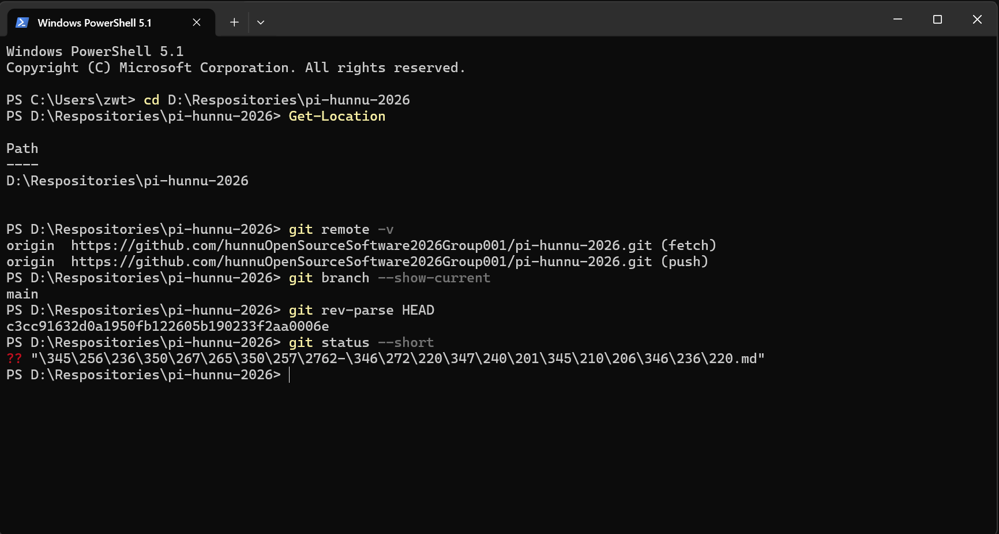
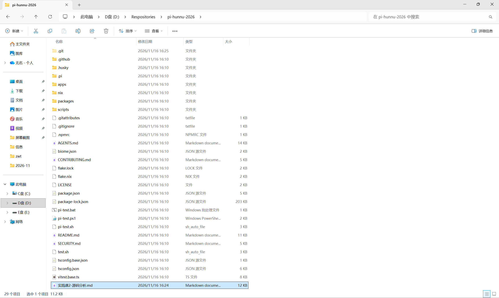
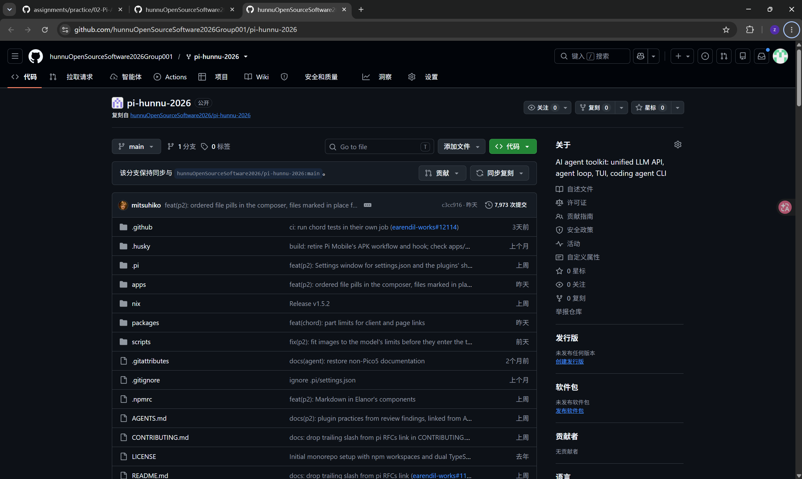
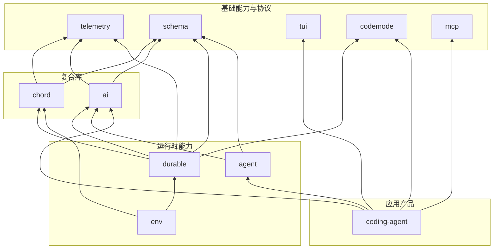

# 实践课2：组织建仓与源码分析

> 姓名拼音：张玟涛　学号：2024302204075　本人重点分析模块：**durable、coding-agent**
>
> 个人作业仓库：<https://github.com/hunnuOpenSourceSoftware2026Group001/wentao-2333_Work>
>
> 分析依据：小组仓库 `main` 分支提交 `340c6e048a189fda989c9bb06cb425b6d5bc6007`（本地目录 `D:\Respositories\Work\pi-hunnu-2026`），截图均来自本机实际操作。

## 一、源码获取与版本确认

- 小组仓库：<https://github.com/hunnuOpenSourceSoftware2026Group001/pi-hunnu-2026>
- 本地目录：`D:\Respositories\Work\pi-hunnu-2026`
- origin：`https://github.com/hunnuOpenSourceSoftware2026Group001/pi-hunnu-2026`
- 当前分支：`main`
- 完整提交编号：`340c6e048a189fda989c9bb06cb425b6d5bc6007`
- clone 命令：`git clone --branch main https://github.com/hunnuOpenSourceSoftware2026Group001/pi-hunnu-2026 pi-hunnu-2026`

本机复核命令（仓库根目录执行）：

```powershell
Get-Location
git remote -v
git branch --show-current
git rev-parse HEAD
git status --short
```

**截图 S1：本地仓库来源与版本**



**截图 S2：本地源码目录（根目录及 packages）**



**截图 S3：小组组织仓库网页**



Issue 正文以纯文本填写实际 clone 地址：`https://github.com/hunnuOpenSourceSoftware2026Group001/pi-hunnu-2026`

## 二、构建顺序与构建方式

根目录 `package.json` 的 `build` 脚本按以下顺序串行进入 `packages` 子目录并执行各自 `npm run build`：

`telemetry → schema → chord → tui → codemode → mcp → ai → durable → env → agent → coding-agent`

子模块普遍使用 `tsconfig.build.json`（继承根 `tsconfig.base.json`，按模块设置 `rootDir: src`、`outDir: dist`），由 `tsc` 生成编译后的 JavaScript 与声明文件。特殊构建也会生成/复制额外制品：`ai` 先生成模型数据并检查，再进行 TypeScript 编译、清理并复制 provider 数据；`coding-agent` 先做 unbundled TypeScript 编译、处理可执行入口及复制资源，再调用根目录 bundle 脚本生成 bundle。根目录脚本本身是串行编排器，不直接把全部源码编译成一个输出；`build:offline` 与常规 build 的区别是 ai 使用 `build:offline`，不运行在线模型生成步骤，而校验离线数据并编译。仓库另有 `build:native:*`、`env` 的 `build:daemon` 等独立构建目标，它们不在根目录默认 build 序列中。

## 三、模块分析表

本人重点分析 `durable` 与 `coding-agent` 两个模块，其余模块按清单逐项核对。“直接依赖”只列 package.json 的 `dependencies` 里能证实的内部运行时模块；外部依赖、开发依赖及 peer dependency 不混作内部运行时依赖。`—` 表示没有声明内部运行时依赖，不代表没有外部依赖。

| 模块 | 代码主要实现什么功能 | 本模块 build 执行什么、生成什么 | 直接依赖哪些内部模块 | 依据文件或代码位置 |
|---|---|---|---|---|
| telemetry | 跨包遥测契约、trace/span、指标和 typed telemetry schema；不绑定某后端。 | `tsc -p tsconfig.build.json`；`dist` 下 JS 与 `.d.ts`。 | — | `packages/telemetry/README.md`；`package.json` scripts/exports；`tsconfig.build.json` |
| schema | JSON Schema 构造与校验器编译，不用 eval，提供 Draft 2020-12/7 支持。 | TypeScript 编译至 `dist`。 | — | `packages/schema/README.md`；`package.json`；`src/index.ts` |
| chord | 多进程对象运行时，包括契约、文档/存储、links、插件热重载、HTTP、workers 及客户端 surfaces。 | TypeScript 编译至 `dist`。 | schema、telemetry | `packages/chord/README.md` Entry points；`package.json` dependencies；`tsconfig.build.json` |
| tui | CLI 终端 UI、差分渲染、组件、输入和终端输出。 | TypeScript 编译至 `dist`；平台 native build 是单独脚本，不是默认 build。 | — | `packages/tui/README.md` Features；`package.json` scripts/dependencies；`tsconfig.build.json` |
| codemode | QuickJS/WASM 沙箱中运行模型生成的 JS，工具调用是沙箱能力边界。 | TypeScript 编译至 `dist`。 | — | `packages/codemode/README.md`；`package.json` dependencies/scripts；`tsconfig.build.json` |
| mcp | 独立 MCP client、stdio/HTTP 与 pipe transports、请求生命周期管理。 | TypeScript 编译至 `dist`。 | — | `packages/mcp/README.md`；`package.json`；`tsconfig.build.json` |
| ai | 统一 LLM/provider API、模型发现和配置。 | `generate-models` → `build:offline`（校验模型数据、tsc、清理/复制 provider data）→ 输出 `dist` 与模型数据。 | schema、telemetry | `packages/ai/package.json` scripts/dependencies；`packages/ai/README.md`；`tsconfig.build.json` |
| durable | 持久化对话、任务、文档 runtime、工具/图片/存储及 scheduler 等。 | TypeScript 编译至 `dist`。 | chord、ai、codemode、schema、telemetry | `packages/durable/package.json` dependencies；`README.md`；`tsconfig.build.json` |
| env | 面向 Pi Durable 的远程执行环境客户端及 SSH daemon。 | 默认 `build` 是 TypeScript 编译至 `dist`；daemon 需显式 `build:daemon` 调用 Cargo。 | chord、durable | `packages/env/package.json` scripts/dependencies；`README.md`；`tsconfig.build.json` |
| agent | 通用 agent 核心，含 transport abstraction、状态管理及附件支持。 | TypeScript 编译至 `dist`。 | ai、schema | `packages/agent/package.json`；`README.md`；`tsconfig.build.json` |
| coding-agent | 面向编码的 CLI agent，集成工具、交互模式、MCP、扩展及会话。 | `build:unbundled` 做 tsc、CLI/RPC 入口准备与静态资源复制；再运行 `scripts/build-coding-agent-bundle.mjs` 生成 bundle。 | agent、ai、codemode、mcp、tui | `packages/coding-agent/package.json` scripts/dependencies；`README.md`；`tsconfig.build.json` |

### 直接依赖图

下方箭头统一为“使用方 → 被依赖方”。可编辑源文件是同目录的 `模块依赖关系.mmd`，可用 Mermaid 编辑器打开、修改并导出图片。图里只纳入已核验的 package.json 直接运行时内部依赖；本表未把 devDependencies/peerDependencies 绘成普通边。根 workspace 的 TypeScript `paths` 指向上游 `dist/*.d.ts` 是类型编译约束/构建顺序佐证，而非额外运行时依赖边。



> 图形分层按职责与依赖位置划分，而非声称所有同层模块可以互换：基础契约层（telemetry、schema）为上层提供通用能力；通用运行时/集成层（chord、tui、codemode、mcp、ai、durable）提供可组合库；应用/环境适配层（env、agent、coding-agent）集成下层能力形成具体运行环境和 CLI。实际依赖以箭头为准，`env`、`agent` 并非彼此依赖。peerDependencies（例如 chord 的可选 esbuild/react/ws）及 devDependencies 是开发/集成条件，不属于图中实线运行时依赖。

## 四、问题回答

### 1. 根目录与子模块 `npm run build` 分别读取什么配置、执行什么工作？

根目录 build 读取根 `package.json` 的 scripts 字段，按固定顺序改变工作目录、逐一调用模块自己的 npm build 命令。workspace 清单也由根 `package.json` 的 `workspaces` 给出（本版本没有 `pnpm-workspace.yaml`）。各模块 build 再读取各自 `package.json` 的 build 脚本；多数调用 `tsc -p tsconfig.build.json`，该配置继承 `tsconfig.base.json` 并指定源码输入、模块特定 `paths`、`rootDir` 和 `dist` 输出。ai 和 coding-agent 在 tsc 之外还有脚本生成、数据校验、资源复制或 bundle 工序。换言之，根 build 负责调度，模块 build 负责按本模块配置编译和准备发布产物。

### 2. 构建顺序与模块依赖有什么关系？相邻构建的模块是否一定互相依赖？

依赖方通常必须等其被依赖方的类型/构建产物先存在，因此顺序大体满足依赖拓扑：例如 `chord` 在 `schema` 后，`durable` 在 chord/ai/codemode 后，`coding-agent` 在 agent/ai/mcp/tui 后。tsconfig 中 durable、env、agent、coding-agent 的 `paths` 指向上游 dist 声明文件，体现这个构建先后条件。相邻模块不保证互相依赖：`chord → tui` 在脚本相邻，但 chord 并不依赖 pi-tui；下一项 codemode 也不是 chord 的依赖。串行序列是便于一次运行的安全次序，不等同于每一对相邻节点都有依赖边。

### 3. 三模块依赖路径的职责分工

选择 `coding-agent → agent → ai → schema` 这条路径。coding-agent 是产品级 CLI，负责把编码工具、交互界面、会话和模型能力组合起来；agent 是通用 agent 核心，提供 transport 与状态等可复用机制；ai 面向不同厂商统一模型/provider API，并依赖 schema/telemetry；schema 提供输入输出结构的构造和校验基础。沿箭头看每个模块使用右侧被依赖能力；更准确说这条路径含四个节点、三条可验证直接依赖边，AI 模块的 schema 边可由 `packages/ai/package.json` dependencies 核验。

## 五、依据与提交检查

- 根调度：根 `package.json` 的 `scripts.build`、`scripts.build:offline` 和 `workspaces`。
- 编译参数：各 `packages/<module>/tsconfig.build.json` 及根 `tsconfig.base.json`。
- 模块功能、导出面和依赖：各模块 `README.md`、`package.json` 的 `scripts`、`dependencies`、`devDependencies`、`peerDependencies`、`exports`。
- 本报告、`模块依赖关系.mmd` 与三张截图（`screenshots/s1.png`、`s2.png`、`s3.png`）均已放入个人作业仓库 `实践课2/`，GitHub 预览可正常显示。
- Issue 标题：`实践课2：组织建仓与源码分析 zhangwentao`；正文包含个人报告链接、小组代码仓库链接，并以文本 URL 贴出 clone 地址。
