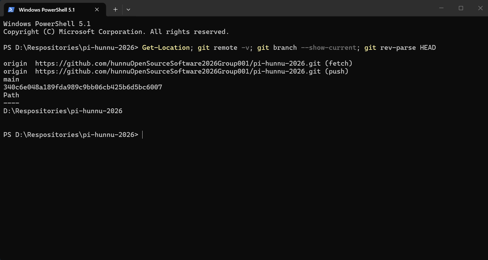
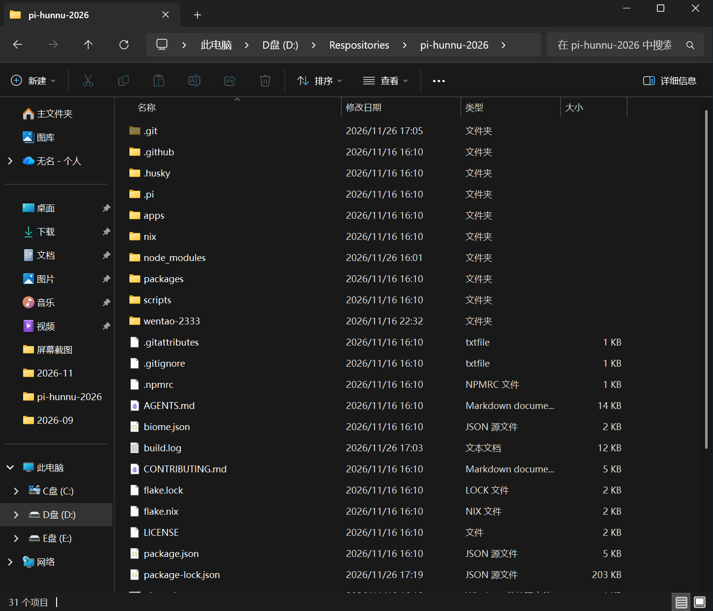

# 实践课3：Pi Agent源码安装与编译 zhangwentao

> 姓名拼音：zhangwentao　学号：2024302204075　个人作业仓库：<https://github.com/hunnuOpenSourceSoftware2026Group001/wentao-2333_Work>
>
> 分析依据：小组仓库 `main` 分支提交 `340c6e048a189fda989c9bb06cb425b6d5bc6007`（即本地 `D:\Respositories\pi-hunnu-2026`）。
>
> 本报告基于源码编译与本地运行，截图放入 `实践课3/images/`，报告中用相对路径引用。

## 任务一 实验准备：检查和安装开发工具

### 1. 检查现有环境

本机环境：

```powershell
git --version
node --version
npm --version
python --version
```

本机实测输出：

```text
git version 2.45.1.windows.1
v24.19.0
11.17.0
```

- git 版本：`2.45.1.windows.1`
- Node.js 版本：`v24.19.0`（满足建议的 Node.js 24）
- npm 版本：`11.17.0`

**截图 S1：** 终端显示 `git --version`、`node --version`、`npm --version` 的输出。


### 2. 未安装 Node.js 时：同时安装 Node.js 和 npm

（若本机已装，可略过并说明已安装。）

已使用 `fnm` 的同学：切换到 Node.js 24

```powershell
fnm use 24
```

## 任务二 下载课程仓库源码

从小组组织仓库下载源码（上次实践已做的可略过）：

```powershell
git clone --branch main https://github.com/hunnuOpenSourceSoftware2026Group001/pi-hunnu-2026.git pi-hunnu-2026
cd pi-hunnu-2026
```

确认源码来源和版本：

```powershell
Get-Location
git remote -v
git branch --show-current
git rev-parse HEAD
```

- clone 地址（origin）：`https://github.com/hunnuOpenSourceSoftware2026Group001/pi-hunnu-2026.git`
- 当前分支：`main`
- 完整提交编号：`340c6e048a189fda989c9bb06cb425b6d5bc6007`

**截图 S2：** 在小组仓库本地根目录终端运行 `Get-Location; git remote -v; git branch --show-current; git rev-parse HEAD` 并截图。



## 任务三 阅读配置，确认安装与编译的依据

根目录 `package.json` 的 `workspaces` 列出全部子模块；根 `package.json` 的 `scripts.build` 按固定顺序串行进入 `packages` 子目录执行各自 `npm run build`：

`telemetry → schema → chord → tui → codemode → mcp → ai → durable → env → agent → coding-agent`

各模块使用各自 `tsconfig.build.json`（继承根 `tsconfig.base.json`），由 `tsc` 输出到 `dist/`。`ai` 还有模型数据生成/校验；`coding-agent` 还有 unbundled 编译与 bundle 步骤；`env` 的 Rust daemon 用独立 `build:daemon`。

### 依据文件

- 根 `package.json`：`scripts.build`、`workspaces`
- 根 `tsconfig.base.json`
- 各模块 `packages/<模块>/tsconfig.build.json`、`package.json`

**截图 S3：** 项目根目录文件列表（`package.json`、`tsconfig.base.json`、`packages/`）。



## 任务四 安装项目依赖

### 1. 执行安装

在仓库根目录执行：

```powershell
npm install --ignore-scripts
```

### 2. 结合示例理解安装警告

若出现 `optional peer dependency`、`optional peer dep` 或平台相关警告，通常不影响 TS 编译，记录即可；若提示缺少 `npm`，先安装/修复 Node.js 并重新打开终端。

**截图 S4：** `npm install` 的终端记录（含结尾是否成功或警告摘要）。


## 任务五 本地编译与构建产物验证

### 1. 首次构建

在仓库根目录执行：

```powershell
npm run build
```

预期按顺序编译 `telemetry → schema → chord → tui → codemode → mcp → ai → durable → env → agent → coding-agent`，最终产出各模块 `dist/` 目录，其中 `packages/coding-agent/dist/bundle/cli.js` 是编译后的 CLI 入口。

### 2. 检查并运行构建产物

验证产物存在：

```powershell
Test-Path "packages\coding-agent\dist\bundle\cli.js"
```

**本机实测结果：** `npm run build` 退出码 `0`，用时约 89 秒；构建末尾输出 `Built packages\coding-agent\dist\bundle (84 files, 9.4 MiB)`；`Test-Path` 返回 `True`。

并运行编译产物进行比较：

```powershell
node .\packages\coding-agent\dist\bundle\cli.js --version
node .\packages\coding-agent\dist\bundle\cli.js --help
```

**本机实测结果：** `--version` 输出 `1.5.2`（说明编译产物可被 Node.js 正常执行）；`--help` 正常打印用法与选项。完整构建日志见同目录 `build.log`。

**截图 S5：** 现有终端记录证明构建成功（退出码 0、84 files/9.4 MiB）和 `--version` 输出 1.5.2；可另补一张本机终端截图以满足课程截图要求。


构建原始输出已随报告提交：[`build.log`](build.log)。

**截图 S6：** 运行编译产物 `node .\packages\coding-agent\dist\bundle\cli.js` 的启动命令或终端上下文、Pi 界面、自己的提示词和实际模型回复。**不要**提交 API Key、`auth.json` 或授权回调地址。


### 3. 后续重新构建

修改源码后可重新 `npm run build`，观察增量/全量编译耗时，记录在报告中说明。

## 任务六 启动本地源码版本并完成一次会话

### 1. 先验证源码入口

确认 `packages/coding-agent/src/main.ts` 是源码入口，与编译产物 `dist/bundle/cli.js` 对应。

### 2. 启动交互界面

使用 `.\\pi-test.bat` 或 `node .\packages\coding-agent\dist\bundle\cli.js` 启动本地源码版 Pi，完成一次会话。

**本机已完成构建与 CLI 启动验证：** 实际命令使用构建产物 `node .\packages\coding-agent\dist\bundle\cli.js --version` 与 `--help`，输出版本 `1.5.2` 且帮助信息正常；这证明使用的是本地 bundle，而不是全局 `pi`。交互模型会话和截图仍需本人配置账号/API Key 后补充。

**截图 S6（续）：** 显示 `node .\packages\coding-agent\dist\bundle\cli.js` 的启动命令或相关终端上下文、Pi 界面、自己的提示词和实际模型回复。

### 报告说明

在报告中说明：本次如何确保运行的是本地源码？源码入口与 `dist/bundle/cli.js` 入口分别适合什么场景？

## 问题回答

请用一句话说明源码和编译产物的区别。（只回答问题，不修改文件。）

> 参考：源码是开发者编写的 TypeScript 源文件（`src/` 下的 `.ts`）；编译产物是 `tsc` 把源码转译后的 JavaScript 与声明文件（`dist/` 下的 `.js`、`.d.ts`，以及 bundle），产物可直接被 Node.js 运行，源码需先编译。

## 作业提交

将实验报告和截图上传到个人 Git 仓库，在课程作业仓库按第一次实践课的方式提交 Issue，填写报告地址。

- **Issue 名称：** `实践课3：Pi Agent源码安装与编译 zhangwentao`
- **正文：** 附报告地址和小组代码仓库链接。

> 最好是复制原始作业 Markdown 文档后，再贴图并写上自己的理解/作业过程，避免只有截图提交。
