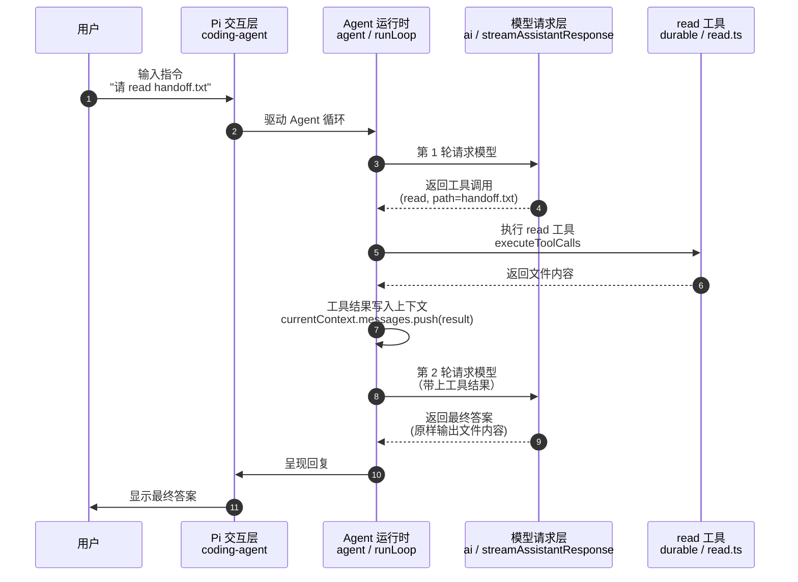

# practice-05

**标题：** 实践课5：Pi Agent 工具调用与会话恢复 zhangwentao  
**个人作业仓库：** <https://github.com/hunnuOpenSourceSoftware2026Group001/wentao-2333_Work>  
**源码依据：** 小组仓库 `pi-hunnu-2026` `main` 分支提交 `340c6e048a189fda989c9bb06cb425b6d5bc6007`，复用实践课 4 的源码环境。

---

## A 阶段：单轮交互与工具调用（复用实践课 4）

在 `practice-05` 工作目录下创建 `handoff.txt`，内容为两行：

```
待办：继续编写 README 启动说明
启动命令：node .\packages\coding-agent\dist\bundle\cli.js
```

启动 Pi，使用 `read` 工具读取当前目录的 `handoff.txt`，并要求 Pi **原样输出**文件内容：

> “请用 `read` 工具读取当前目录的 `handoff.txt`，并原样输出文件中的两行内容。只输出文件内容，不要加解释。”

记录：Pi 是否调用了 `read` 工具，是否读到了文件中的两行内容，最终回复是否与 `handoff.txt` 内容一致。

**截图：** 显示 `handoff.txt` 内容、Pi 的 `read` 工具调用记录、Pi 原样输出的两行内容。

---

## B 阶段：恢复上次会话，继续写 README

A 阶段已经让 Pi 读到了 `handoff.txt` 中的启动命令。现在退出 Pi，再启动它，比较“接着原会话问”和“另开新会话问”这两种情况。

### 1. 恢复原会话

退出 Pi，在同一个项目目录用原来的本地启动命令加上 `-c`（`--continue` 的简写）重新打开：

```powershell
node .\packages\coding-agent\dist\bundle\cli.js -c
```

确认终端里能看到 A 阶段的聊天记录。然后输入：

> “接着上次的待办，给 README 起草一条启动说明，写出交接单里的完整启动命令。只用这次会话已有的信息。不要调用工具。如果缺少命令，请直接说明。”

记录恢复后的回答是否包含 A 阶段的完整启动命令，以及是否重新读了文件。

### 2. 新建会话

用 `/new` 开始新会话，在同一个项目目录、用同一个模型，输入完全相同的话：

> “接着上次的待办，给 README 起草一条启动说明，写出交接单里的完整启动命令。只用这次会话已有的信息。不要调用工具。如果缺少命令，请直接说明。”

记录新会话的回答。若恢复后的回答包含 A 的完整命令且没有重新读文件，就有证据支持它使用了已恢复的会话历史；若实际又读了文件或回答不符合预期，照实记录。

---

## 图 1：单轮工具调用的代码级时序图

图 1 展示单轮工具调用（`read` 工具）的代码级调用链，五条生命线：用户、Pi 交互层（coding-agent）、Agent 运行时（agent）、模型请求层（ai）、`read` 工具（durable）。



**说明：**
- 第 1 轮：模型根据用户指令，决定调用 `read` 工具，返回工具调用指令。
- Agent 运行时执行 `read` 工具，把文件内容读回，写入上下文（`messages.push(result)`）。
- 第 2 轮：模型带着工具结果（文件内容）再次请求，生成最终答案。

---

## 图 2：恢复旧会话 vs 新建会话的对照图

两条分支都从“A 阶段已经结束，Pi 已经读到并回答了启动命令”开始。

```mermaid
flowchart TD
    Start[ A 阶段结束：<br/>Pi 已读到并回答了启动命令 ] -->|退出 Pi，<br/>加 -c 重新启动| Restore[ 恢复旧会话 ] 
    Start -->|输入 /new，<br/>新建会话| New[ 新建会话 ]

    Restore --> R1[ Pi 打开 A 阶段保存的<br/>会话文件 ]
    Restore --> R2[ Pi 从文件中恢复<br/>历史消息 ]
    Restore --> R3[ 用户输入：<br/>"接着上次的待办……" ]
    Restore --> R4[ Pi 把恢复出的历史消息<br/>和本次提问一起<br/>用于请求模型 ]
    Restore --> R5[ 回答包含 A 阶段的<br/>完整启动命令，<br/>无需重新读文件 ]

    New --> N1[ Pi 创建聊天历史为空<br/>的新会话 ]
    New --> N2[ 用户输入完全相同的话 ]
    New --> N3[ Pi 只用本次提问<br/>请求模型 ]
    New --> N4[ 新会话历史里没有<br/>A 阶段读到的启动命令 ]
    New --> N5[ 若缺少命令，直接说明<br/>（或重新读文件） ]

    style Start fill:#e1f5e1,stroke:#2e7d32
    style R5 fill:#fff9c4,stroke:#f9a825
    style N5 fill:#ffcdd2,stroke:#c62828
```

**对照结论：**
- 恢复旧会话（`-c`）：Pi 打开 A 阶段保存的会话文件，把历史消息（包括已读到的 `handoff.txt` 启动命令）和本次提问一起发给模型，因此回答里包含完整启动命令且**不需要重新读文件**。
- 新建会话（`/new`）：聊天历史为空，模型只能根据本次提问作答，历史里没有 A 阶段的启动命令，可能回答“缺少命令”或重新读文件。

---

## 作业提交

在个人作业仓库提交一份 `practice-05.md`，报告须包含图 1、图 2，可进一步增加解释/文字说明。

在课程作业仓库 <https://github.com/hunnuOpenSourceSoftware2026/assignments/issues/new/choose> 提交一条 Issue：

- **标题：** `实践课5：Pi Agent工具调用与会话恢复 zhangwentao`
- **正文：** 附作业链接（个人报告地址和小组代码仓库链接）。
